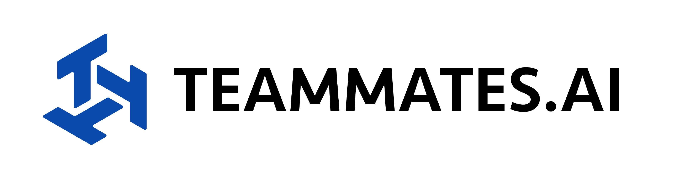

<p align="center">
  <a href="https://teammates.ai">
    <picture>
      <source media="(prefers-color-scheme: dark)" srcset="assets/wordmark-dark.png" />
      <source media="(prefers-color-scheme: light)" srcset="assets/wordmark-light.png" />
      
    </picture>
  </a>
</p>

<h3 align="center">Give your agent a real team.</h3>

<p align="center">
  Launch an AI-Run Business or delegate sales, support, and recruiting with <strong>Teammates.ai</strong>.<br />
  Connect Antigravity, Claude, Cursor, Codex, or Gemini CLI over OAuth 2.1. Zero API keys. 1-tap founder approvals.
</p>

<p align="center">
  <a href="https://teammates.ai/mcp"></a>
  <a href="SECURITY.md"></a>
  <a href="LICENSE"></a>
</p>

<p align="center">
  <a href="https://teammates.ai/mcp">Setup Guide</a> &nbsp;&middot;&nbsp;
  <a href="https://teammates.ai/pricing">Pricing</a> &nbsp;&middot;&nbsp;
  <a href="SECURITY.md">Security</a> &nbsp;&middot;&nbsp;
  <a href="https://hq.teammates.ai">Open HQ</a>
</p>

<p align="center">
  
</p>

---

## Just ask your agent

Once connected, talk to your Teammates.ai workspace in plain English or Arabic:

```text
"Launch an AI-Run Business website for my boutique Pilates studio in Dubai and shoot the campaign visuals."
```

```text
"Have Adam find 25 B2B fintech leads in the US and draft personalized outreach for my review."
```

```text
"Ask Raya to update our shipping policy in support knowledge and draft a reply to this customer ticket."
```

```text
"Check my Teammates.ai workspace status, Credit balance, and any pending approvals."
```

---

## Five specialist teammates, one workspace

Each teammate owns a distinct job. None of them are merged into a generic chatbot.

| Teammate | Role | What you can delegate | Mode |
| --- | --- | --- | --- |
| **AI Engineer** | Websites & campaign visuals | Launch or clone live storefronts, edit copy, pricing, or sections, and shoot campaign visuals | AI-Run Business |
| **AI Co-Founder** | Executive ops & planning | Synthesize workspace health, priorities, ad packs, and cross-teammate execution plans | Both modes |
| **Raya** | Customer support | Search and update support knowledge and draft grounded customer replies | Both modes |
| **Adam** | B2B sales | Discover ICP prospects and stage personalized outbound outreach | Both modes |
| **Sara** | Recruiting | Draft job roles and review cited candidate scorecards | Both modes |

---

## Connect in 10 seconds

### Option 1: Copy and send this to any AI agent

```text
Connect Teammates.ai MCP to my workspace:
1. Add the remote Streamable HTTP MCP server https://api-hq.teammates.ai/mcp (name: "Teammates.ai", OAuth 2.1 browser sign-in, no API key needed).
2. Trigger the browser sign-in flow and confirm which Teammates.ai tools are ready.
```

### Option 2: Direct setup by client

| Client | How to connect |
| --- | --- |
| **Google Antigravity** | Install this plugin, then click **Sign in** to authorize your workspace in the browser. |
| **Claude** | [Add Teammates.ai custom connector](https://claude.ai/customize/connectors?modal=add-custom-connector&connectorName=Teammates.ai&connectorUrl=https%3A%2F%2Fapi-hq.teammates.ai%2Fmcp) and sign in with OAuth 2.1. |
| **Claude Code** | Run `claude mcp add --transport http teammates https://api-hq.teammates.ai/mcp` |
| **Cursor** | Open [teammates.ai/mcp](https://teammates.ai/mcp) for the 1-click Cursor installer, or add `https://api-hq.teammates.ai/mcp` as a remote HTTP MCP server. |
| **Codex / Gemini CLI** | Add `https://api-hq.teammates.ai/mcp` as a Streamable HTTP MCP server with OAuth 2.1 sign-in. |

---

## Built for real businesses, not reckless autonomy

- **Zero API keys.** Uses OAuth 2.1 Authorization Code with mandatory PKCE (`S256`) and Dynamic Client Registration at `https://api-hq.teammates.ai/mcp`. Revoke access anytime from your workspace.
- **Safe by default.** Internal research, workspace updates, and drafts run fast. External customer replies, outbound emails, job-board posts, and paid ad spend stage safely and wait for your 1-tap approval on [hq.teammates.ai](https://hq.teammates.ai).
- **Nothing hidden in this repo.** Pure manifests and plain Markdown skills connected to our live remote MCP server (`https://api-hq.teammates.ai/mcp`). Zero compiled code, zero telemetry, and every new Teammates.ai upgrade flows automatically to every connected client without reinstalling.

---

## Plans

| Plan | Price | Included |
| --- | --- | --- |
| **Free** | `$0` (no card required) | Your first AI-Run Business launch + 5 starter Credits |
| **Pro** | `$50/mo` | 160 Credits/mo, paid from day one |
| **Business** | `$250/mo` | 900 Credits/mo, paid from day one |
| **Scale** | `$500/mo` | 2,000 Credits/mo, paid from day one |

Full plan details at [teammates.ai/pricing](https://teammates.ai/pricing).

---

## Repository layout

```text
teammates-plugin/
├── plugin.json              # Antigravity plugin manifest
├── gemini-extension.json    # Gemini CLI extension manifest
├── mcp.json / mcp_config.json
├── skills/                  # 4 Markdown skills (routing, launch, operations, approvals)
├── assets/                  # Brand marks and hero graphic
└── SECURITY.md              # Vulnerability disclosure and OAuth boundaries
```

Questions or partnership inquiries: [support@teammates.ai](mailto:support@teammates.ai)
